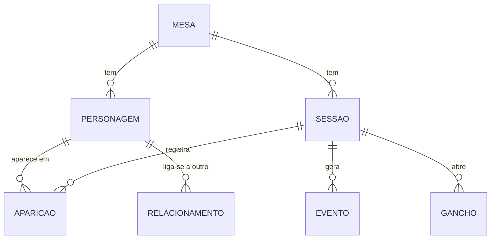

# Gíria Mestre — MVP: caderno de campanhas

> Versão de 21/10/2026. Documento vivo: a versão editável e comentável está no [Claude Docs](https://claude.ai/artifact/VTtJhE5XBhKLnfc6ESEYna).

## Premissas e perguntas em aberto

O primeiro passo da Gíria Mestre é um **caderno de campanhas de uso pessoal do mestre**: um repositório das mesas em andamento com personagens, diários de sessão e o histórico de tudo que aconteceu. A gestão comercial (agenda, jogadores pagantes, cobranças) fica para uma fase futura e está descrita em [fase-futura-gestao-comercial.md](fase-futura-gestao-comercial.md).

Perguntas que mudam o escopo:

1. Quais sistemas e cenários são mestrados (D&D 5e, Tormenta, Ordem Paranormal, cenário próprio)? Considerei que as anotações são narrativas, sem ficha mecânica com atributos e cálculos.
2. Onde estão as anotações hoje (Notion, Obsidian, Google Docs, caderno)? Vale importar o que já existe?
3. A plataforma vai ser consultada durante a sessão, no celular ou no notebook? Precisa funcionar sem internet?
4. É preciso guardar imagens: retratos de personagens, mapas, handouts?
5. Algumas mesas compartilham o mesmo mundo, com NPCs e lugares em comum?
6. Além de personagens, é preciso registrar locais, facções e itens já no começo, ou isso pode esperar?
7. Quantas mesas estão em andamento hoje e mais ou menos quantas sessões cada uma já teve?

## Visão do produto

**A Gíria Mestre é o grimório do mestre:** cada mesa tem o seu elenco, o seu diário e a sua linha do tempo, e tudo está ligado entre si.

**Problema.** As anotações de campanha costumam ficar espalhadas em cadernos, documentos e mensagens. Com o tempo fica difícil lembrar o nome daquele NPC da sessão 4, o que um personagem prometeu a quem, ou qual gancho ficou sem resposta. Relê-las para preparar a próxima sessão toma tempo.

**Proposta de valor.**

- Uma página por mesa com tudo o que importa: personagens, sessões, ganchos em aberto e linha do tempo.
- Background de cada personagem, jogador ou NPC, num só lugar, com as sessões em que ele apareceu.
- Diário de sessão que alimenta sozinho o histórico da mesa: ao citar um personagem ou registrar um evento, o vínculo é criado.
- Busca que encontra qualquer nome ou acontecimento em segundos.

**Objetivo do MVP.** Todas as mesas em andamento registradas na plataforma, com um diário por sessão, e a preparação da próxima sessão feita a partir dela.

## Escopo: MVP, próximas fases e fora de escopo

O MVP é só para o mestre e cobre três coisas: personagens, diários de sessão e histórico. Compartilhar com jogadores e a gestão comercial ficam para quando o caderno estiver em uso.

**MVP (caderno do mestre)**

- **Mesas:** nome, sistema, cenário, status (em andamento, pausada, encerrada), sinopse, jogadores e capa.
- **Personagens:** PJs e NPCs, com aparência, personalidade, background, objetivos, relacionamentos, situação (vivo, morto, desaparecido), retrato e notas secretas do mestre.
- **Diário de sessão:** preparação antes da sessão e relato depois, com personagens presentes, acontecimentos e ganchos.
- **Histórico da mesa:** linha do tempo de eventos marcantes, ligados à sessão e aos personagens envolvidos.
- **Ganchos em aberto:** pendências da trama por mesa, marcadas como resolvidas quando fecham.
- **Menções:** citar um personagem no texto (ex.: @Kael) cria o vínculo e a página dele mostra onde ele apareceu.
- **Busca** em todas as mesas, personagens e diários.
- **Editor de texto** com formatação, imagens e salvamento automático.
- **Exportar** tudo (Markdown ou PDF) e backup.

**Fase 2 (caderno mais completo, ainda só do mestre)**

- Locais, facções e itens como páginas próprias, com menções.
- Tags e filtros; mapa visual de relacionamentos entre personagens.
- Modelos de diário e de personagem; calendário do mundo de jogo.
- Mundos compartilhados entre mesas.
- Importação de Notion, Obsidian ou Google Docs; uso sem internet.
- Resumo de sessão assistido por IA a partir das anotações.

**Fase 3 (expansão)**

- Visão do jogador: compartilhar o diário e as páginas de personagem, escondendo as notas secretas.
- Jogadores escrevem o próprio background.
- Gestão de mesas comissionadas: agenda, jogadores pagantes e cobranças ([fase-futura-gestao-comercial.md](fase-futura-gestao-comercial.md)).
- Contas para outros mestres.

**Fora de escopo**

- Mesa virtual (VTT), rolagem de dados e mapas táticos.
- Ficha de personagem mecânica com atributos e cálculos de regras.

## Requisitos funcionais

São 15 requisitos, todos do MVP.

| ID | Requisito |
| --- | --- |
| RF01 | O mestre faz login com e-mail e senha (ou Google). |
| RF02 | O mestre cria, edita, pausa, encerra e arquiva mesas. |
| RF03 | A página da mesa mostra sinopse, personagens, sessões, ganchos em aberto e linha do tempo. |
| RF04 | O mestre cria personagens do tipo PJ (com o nome do jogador) ou NPC, com os campos de background. |
| RF05 | Cada personagem tem um campo de notas secretas, visível só para o mestre. |
| RF06 | O mestre registra relacionamentos entre personagens (ex.: "irmã de", "deve um favor a"). |
| RF07 | O mestre cria uma sessão com número, data, título, preparação e relato. |
| RF08 | Ao escrever, o mestre menciona personagens com @ e o sistema registra a aparição na sessão. |
| RF09 | A página do personagem lista as sessões em que ele apareceu e os eventos de que participou. |
| RF10 | O mestre registra eventos marcantes na linha do tempo, ligados a uma sessão e a personagens. |
| RF11 | O mestre cria ganchos, os liga à sessão em que surgiram e os marca como resolvidos. |
| RF12 | A busca encontra mesas, personagens, sessões e trechos de texto. |
| RF13 | O editor aceita formatação básica, imagens e salva automaticamente. |
| RF14 | O mestre exporta uma mesa inteira em Markdown ou PDF. |
| RF15 | Itens excluídos vão para uma lixeira e podem ser restaurados. |

## Requisitos não funcionais

O caderno precisa ser privado, rápido de consultar durante a sessão e nunca perder um texto.

| ID | Categoria | Requisito |
| --- | --- | --- |
| RNF01 | Privacidade | Todo o conteúdo é privado do mestre; nada fica público sem ação explícita. |
| RNF02 | Segurança dos textos | Salvamento automático a cada poucos segundos e histórico de versões nos textos longos (background e diário). |
| RNF03 | Usabilidade | Leitura confortável no celular durante a sessão; escrita longa pensada para o computador. |
| RNF04 | Desempenho | Busca devolve resultados em menos de 1 segundo; páginas abrem em menos de 2 segundos. |
| RNF05 | Portabilidade | Exportação em formato aberto (Markdown): os dados continuam do mestre se a plataforma mudar. |
| RNF06 | Backup | Backup diário automático do banco e das imagens. |
| RNF07 | Idioma | Interface em português do Brasil. |
| RNF08 | Custo | Hospedagem gratuita ou de baixo custo enquanto houver um único usuário. |
| RNF09 | Evolução | Modelo de dados preparado para vários usuários e para a visão do jogador, sem precisar refazer o banco. |

## Regras de negócio

As regras do caderno são sobre como as informações se ligam e como nada se perde; as marcadas com "sugerido" são propostas para validar.

| ID | Área | Regra |
| --- | --- | --- |
| RN01 | Mesa | Todo personagem, sessão, evento e gancho pertence a uma mesa. Mundos compartilhados ficam para a Fase 2. |
| RN02 | Mesa | Status possíveis: Em andamento, Pausada, Encerrada. Mesa encerrada continua editável e consultável. |
| RN03 | Personagem | Todo personagem é PJ ou NPC. PJ tem o nome do jogador; NPC não. |
| RN04 | Personagem | Personagem morto ou desaparecido nunca some do histórico: muda de situação, não é apagado. |
| RN05 | Personagem | Notas secretas são marcadas como "só mestre" desde o início, para que nunca apareçam numa futura visão do jogador. |
| RN06 | Sessão | Sessões são numeradas em sequência dentro da mesa; o número é sugerido e pode ser editado. |
| RN07 | Sessão | Status possíveis: Planejada (só preparação), Realizada (com relato), Cancelada. |
| RN08 | Sessão | Mencionar um personagem no relato registra a aparição dele naquela sessão; remover a menção remove a aparição. |
| RN09 | Linha do tempo | Eventos são ordenados pela sessão; uma data no mundo de jogo é opcional (sugerido). |
| RN10 | Ganchos | Um gancho nasce numa sessão e fica aberto até ser marcado como resolvido, com a sessão em que se resolveu. |
| RN11 | Ganchos | Ao criar uma nova sessão, os ganchos em aberto aparecem na preparação (sugerido). |
| RN12 | Exclusão | Excluir manda para a lixeira por 30 dias antes de apagar de vez (sugerido). |

## Entidades e modelo de dados

O MVP precisa de 7 entidades; a Aparição é o que faz o caderno se organizar sozinho, porque nasce de cada menção a um personagem no diário.

Eventos também se ligam aos personagens envolvidos, e um gancho guarda a sessão em que surgiu e a sessão em que foi resolvido.

| Entidade | Atributos principais |
| --- | --- |
| Mesa | nome, sistema, cenário, status, sinopse, jogadores, capa |
| Personagem | mesa, tipo (PJ ou NPC), nome, jogador (só PJ), aparência, personalidade, background, objetivos, situação, retrato, notas secretas |
| Relacionamento | personagem A, personagem B, descrição (ex.: "mentor de") |
| Sessão | mesa, número, data, título, status, preparação, relato |
| Aparição | sessão, personagem (gerada pelas menções) |
| Evento | mesa, sessão, título, descrição, personagens envolvidos, data no mundo de jogo (opcional) |
| Gancho | mesa, descrição, sessão de origem, status, sessão de resolução |

## Fluxos principais

O uso gira em torno do ciclo de cada sessão: preparar, jogar, registrar, e o que foi registrado alimenta a próxima preparação.

**Ciclo de uma sessão**

1. O mestre cria a próxima sessão da mesa; ela nasce como Planejada, com os ganchos em aberto listados.
2. Escreve a preparação: cenas previstas, NPCs que vão aparecer, segredos a revelar.
3. Durante a sessão, consulta personagens e o histórico pelo celular ou notebook, e anota rapidamente o que surgir.
4. Depois da sessão, escreve o relato e menciona os personagens que participaram.
5. Marca os eventos marcantes para a linha do tempo, cria os novos ganchos e resolve os que fecharam.
6. A sessão passa para Realizada; páginas de personagem, linha do tempo e ganchos já estão atualizados para a próxima.

**Começar uma mesa**

1. O mestre cria a mesa com nome, sistema, cenário e sinopse.
2. Cadastra os PJs com o nome dos jogadores e o background de cada um.
3. Cadastra os NPCs principais e os relacionamentos entre eles e os PJs.
4. Se a mesa já está em andamento, registra um resumo das sessões anteriores como eventos da linha do tempo.

**Reencontrar uma informação**

1. O mestre busca um nome ou palavra.
2. Abre o personagem e vê o background, as sessões em que apareceu e os eventos de que participou.
3. Navega para a sessão ou evento e lê o trecho no contexto.

## Métricas de sucesso

O MVP dá certo se, depois de um mês, a plataforma for o único lugar onde o mestre anota e consulta suas mesas.

- Todas as mesas em andamento cadastradas, com PJs e NPCs principais.
- Um diário escrito para cada sessão jogada, em até 2 dias depois dela.
- Qualquer personagem ou acontecimento encontrado em menos de 10 segundos.
- Preparação de sessão feita a partir da plataforma, sem voltar a anotações antigas.

## Riscos e mitigação

O maior risco é virar "mais um Notion": ferramentas como Notion, Obsidian, World Anvil e Kanka já existem, então o diferencial precisa ser o fluxo de sessão e os vínculos automáticos.

| Risco | Impacto | Mitigação |
| --- | --- | --- |
| Não ser melhor que as ferramentas que o mestre já usa | Alto | Focar no ciclo da sessão, menções e ganchos; testar com mesas reais desde as primeiras semanas |
| Escopo crescer para worldbuilding completo (mapas, genealogias, wikis) | Alto | Locais, facções e itens só na Fase 2; manter a lista "Fora de escopo" |
| Perder textos escritos | Alto | Salvamento automático, histórico de versões, backup diário e exportação |
| Migrar as anotações antigas dá trabalho demais | Médio | Permitir começar com um resumo por mesa; importação na Fase 2 |
| Editor ruim no celular atrapalha durante a sessão | Médio | No celular, priorizar leitura e anotação rápida; escrita longa no computador |
| Expandir para jogadores exigir refazer o sistema | Médio | Notas secretas marcadas desde já e dados separados por usuário (RN05, RNF09) |

## Checklist pré-desenvolvimento e próximos passos

O próximo passo é responder as perguntas do início; com elas fechamos o escopo e partimos para os wireframes.

**Produto**

- [x] Visão, escopo, requisitos e regras do caderno (este documento)
- [ ] Responder as perguntas em aberto
- [ ] Escrever as histórias de usuário do MVP com critérios de aceite
- [ ] Escolher uma mesa real para ser a primeira a entrar na plataforma

**Design**

- [ ] Wireframes: página da mesa, página do personagem, diário de sessão, linha do tempo e busca
- [ ] Protótipo clicável testado com essa mesa real
- [ ] Identidade visual básica (cores, tipografia, tom de fantasia)

**Técnico**

- [x] Criar o repositório
- [ ] Escolher a stack (sugestão: Next.js + Supabase com Postgres, autenticação e armazenamento de imagens + Vercel, todos com plano gratuito)
- [ ] Escolher o editor de texto com suporte a menções (ex.: Tiptap)
- [ ] Modelar o banco a partir das entidades deste documento
- [ ] Configurar ambiente, deploy automático e backup

**Roadmap sugerido:** 1) wireframes e modelo de dados; 2) mesas e personagens; 3) diário com menções; 4) linha do tempo, ganchos e busca; 5) um mês de uso real e ajustes; 6) Fase 2.
