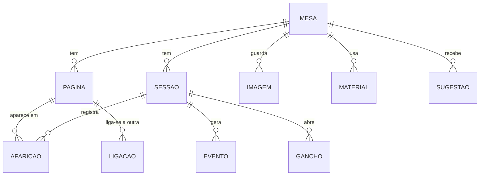

# Gíria Mestre — MVP: caderno de campanhas

> Versão de 21/10/2026. Documento vivo: a versão editável e comentável está no [Claude Docs](https://claude.ai/artifact/VTtJhE5XBhKLnfc6ESEYna).

## Premissas e respostas

O primeiro passo da Gíria Mestre é um **caderno de campanhas de uso pessoal do mestre** para as campanhas de Tormenta 20: um lugar único com personagens, locais, facções, itens, diários de sessão e o histórico de cada mesa. A gestão comercial (agenda, jogadores pagantes, cobranças) fica para uma fase futura e está em [fase-futura-gestao-comercial.md](fase-futura-gestao-comercial.md).

| Pergunta | Resposta | O que muda no plano |
| --- | --- | --- |
| Sistemas mestrados | Tormenta 20 | Personagens ganham campos opcionais de T20 (raça, classe, origem, divindade, nível), sem ficha mecânica |
| Onde estão as anotações hoje | Projetos separados por campanha e uma conversa de anotações; a ideia é unificar tudo | No MVP o conteúdo entra colando os textos; importação assistida fica na Fase 2 |
| Guardar imagens | Sim | Retratos, capa da mesa e uma galeria por mesa para mapas e handouts |
| Mesas no mesmo mundo | Não, cada campanha é única | Cada mesa é isolada; mundos compartilhados saem do roadmap |
| Locais, facções e itens já no começo | Sim | Entram no MVP como páginas próprias, mencionáveis com @ |
| Mesas em andamento | 3, com novas no futuro | As 3 mesas são a meta de migração; criar mesas novas é livre |
| Uso durante a sessão | Sim, no celular e no desktop | Interface responsiva desde o primeiro dia: cada tela é desenhada para celular e desktop; uso sem internet continua na Fase 2 |

## Visão do produto

**A Gíria Mestre é o grimório do mestre:** cada mesa tem o seu elenco, o seu diário e a sua linha do tempo, e tudo está ligado entre si.

**Problema.** As anotações de campanha costumam ficar espalhadas em cadernos, documentos e mensagens. Com o tempo fica difícil lembrar o nome daquele NPC da sessão 4, o que um personagem prometeu a quem, ou qual gancho ficou sem resposta. Relê-las para preparar a próxima sessão toma tempo.

**Proposta de valor.**

- Uma página por mesa com tudo o que importa: personagens, sessões, ganchos em aberto e linha do tempo.
- Background de cada personagem, jogador ou NPC, num só lugar, com as sessões em que ele apareceu.
- Diário de sessão que alimenta sozinho o histórico da mesa: ao citar um personagem ou registrar um evento, o vínculo é criado.
- Busca que encontra qualquer nome ou acontecimento em segundos.

**Objetivo do MVP.** Todas as mesas em andamento registradas na plataforma, com um diário por sessão, e a preparação da próxima sessão feita a partir dela.

## Escopo: MVP, próximas fases e fora de escopo

O MVP é só para o mestre e cobre quatro coisas: as páginas da campanha (personagens, locais, facções e itens), os diários de sessão, o histórico e um assistente que lê o PDF da aventura e os backgrounds para sugerir a preparação da próxima sessão. Compartilhar com jogadores e a gestão comercial ficam para quando o caderno estiver em uso.

**MVP (caderno do mestre)**

- **Painel de campanhas:** primeira tela após o login, com uma miniatura por campanha (capa, nome, sessões, próxima sessão e ganchos em aberto). Cada miniatura abre o resumo da campanha.
- **Resumo da campanha:** nome, descrição, última sessão com o que aconteceu, próximas sessões e as sugestões de preparação.
- **Material da campanha:** envio do PDF da aventura; a plataforma lê o conteúdo e acompanha em que capítulo o grupo está.
- **Assistente de preparação:** a partir do PDF, dos backgrounds e do histórico, sugere o que vem pela frente, ganchos para tratar e objetivos pessoais de cada personagem, sempre citando a fonte. O mestre aceita, edita ou descarta.
- **Mesas:** nome, sistema (Tormenta 20 como padrão), cenário, status (em andamento, pausada, encerrada), sinopse, jogadores e capa. Cada mesa é isolada das outras.
- **Personagens:** PJs e NPCs, com aparência, personalidade, background, objetivos (inclusive os sugeridos e aceitos), relacionamentos, situação (vivo, morto, desaparecido), retrato, notas secretas e campos opcionais de T20 (raça, classe, origem, divindade, nível).
- **Locais, facções e itens:** páginas próprias com descrição, imagem, notas secretas e ligações (ex.: facção sediada num local, item em posse de um personagem).
- **Diário de sessão:** preparação antes da sessão e relato depois, com acontecimentos e ganchos.
- **Menções:** citar qualquer página no texto (ex.: @Kael, @Valkaria) cria o vínculo, e a página mostra em que sessões apareceu.
- **Histórico da mesa:** linha do tempo de eventos marcantes, ligados à sessão e às páginas envolvidas.
- **Ganchos em aberto:** pendências da trama por mesa, marcadas como resolvidas quando fecham.
- **Imagens:** retratos, capas e uma galeria por mesa para mapas e handouts.
- **Busca** em todas as mesas e páginas.
- **Editor de texto** com formatação, imagens e salvamento automático.
- **Exportar** tudo (Markdown ou PDF) e backup.

**Fase 2 (caderno mais completo, ainda só do mestre)**

- Importação assistida: colar uma conversa ou documento de anotações e a plataforma sugerir as páginas e sessões a criar.
- Tags e filtros; mapa visual de relacionamentos entre personagens e facções.
- Modelos de diário e de personagem; calendário do mundo de jogo.
- Uso sem internet, se a conexão durante as sessões se mostrar um problema.
- Resumo automático do relato a partir das anotações feitas durante a sessão.

**Fase 3 (expansão)**

- Visão do jogador: compartilhar o diário e as páginas de personagem, escondendo as notas secretas.
- Jogadores escrevem o próprio background.
- Gestão de mesas comissionadas: agenda, jogadores pagantes e cobranças ([fase-futura-gestao-comercial.md](fase-futura-gestao-comercial.md)).
- Contas para outros mestres.

**Fora de escopo**

- Mesa virtual (VTT), rolagem de dados e mapas táticos.
- Ficha de personagem mecânica com atributos e cálculos de regras.

## Requisitos funcionais

São 22 requisitos, todos do MVP; RF18 a RF22 cobrem o painel e o assistente de preparação.

| ID | Requisito |
| --- | --- |
| RF01 | O mestre faz login com e-mail e senha (ou Google). |
| RF02 | O mestre cria, edita, pausa, encerra e arquiva mesas, sem limite de quantidade. |
| RF03 | A página da mesa mostra sinopse, personagens, locais, facções, itens, sessões, ganchos em aberto e linha do tempo. |
| RF04 | O mestre cria personagens do tipo PJ (com o nome do jogador) ou NPC, com os campos de background e os campos opcionais de Tormenta 20. |
| RF05 | O mestre cria páginas de locais, facções e itens, com descrição e imagem. |
| RF06 | Toda página tem um campo de notas secretas, visível só para o mestre. |
| RF07 | O mestre liga páginas entre si com uma descrição (ex.: "irmã de", "membro de", "sediada em", "em posse de"). |
| RF08 | O mestre cria uma sessão com número, data, título, preparação e relato. |
| RF09 | Ao escrever, o mestre menciona qualquer página com @ e o sistema registra a aparição na sessão. |
| RF10 | Cada página lista as sessões em que apareceu, os eventos de que participou e as páginas ligadas a ela. |
| RF11 | O mestre registra eventos marcantes na linha do tempo, ligados a uma sessão e a páginas. |
| RF12 | O mestre cria ganchos, os liga à sessão em que surgiram e os marca como resolvidos. |
| RF13 | Cada mesa tem uma galeria de imagens (mapas, handouts) que podem ser inseridas nos textos. |
| RF14 | A busca encontra mesas, páginas, sessões e trechos de texto. |
| RF15 | O editor aceita formatação básica, imagens, colagem de textos longos e salva automaticamente. |
| RF16 | O mestre exporta uma mesa inteira em Markdown ou PDF. |
| RF17 | Itens excluídos vão para uma lixeira e podem ser restaurados. |
| RF18 | Após o login, o mestre vê o painel com uma miniatura por campanha, filtrável por status; clicar abre o resumo da campanha. |
| RF19 | O resumo mostra nome, descrição, última sessão com seus eventos, próximas sessões e as sugestões para a próxima. |
| RF20 | O mestre envia o PDF da aventura; o sistema extrai o texto, divide em capítulos e o mestre indica (ou confirma) o capítulo atual. |
| RF21 | O assistente gera, para a próxima sessão, uma síntese do que vem, ganchos sugeridos e objetivos pessoais por personagem, cada item com a fonte (página do PDF, background ou sessão). |
| RF22 | O mestre aceita, edita ou descarta cada sugestão; as aceitas viram ganchos, objetivos do personagem ou itens da preparação. |

## Requisitos não funcionais

O caderno precisa ser privado, rápido de consultar durante a sessão e nunca perder um texto.

| ID | Categoria | Requisito |
| --- | --- | --- |
| RNF01 | Privacidade | Todo o conteúdo é privado do mestre; nada fica público sem ação explícita. |
| RNF02 | Segurança dos textos | Salvamento automático a cada poucos segundos e histórico de versões nos textos longos (background e diário). |
| RNF03 | Usabilidade | Interface responsiva: todas as telas funcionam no celular e no desktop. No celular, prioridade para consulta rápida e anotações curtas durante a sessão; no desktop, escrita longa e visão lado a lado (ex.: diário e página do personagem). |
| RNF04 | Desempenho | Busca devolve resultados em menos de 1 segundo; páginas abrem em menos de 2 segundos. |
| RNF05 | Portabilidade | Exportação em formato aberto (Markdown): os dados continuam do mestre se a plataforma mudar. |
| RNF06 | Backup | Backup diário automático do banco e das imagens. |
| RNF07 | Idioma | Interface em português do Brasil. |
| RNF08 | Custo | Hospedagem gratuita ou de baixo custo enquanto houver um único usuário. |
| RNF09 | Evolução | Modelo de dados preparado para vários usuários e para a visão do jogador, sem precisar refazer o banco. |

## Regras de negócio

As regras do caderno são sobre como as informações se ligam e como nada se perde; as marcadas com "sugerido" são propostas para validar.

| ID | Área | Regra |
| --- | --- | --- |
| RN01 | Mesa | Toda página, sessão, evento e gancho pertence a uma única mesa. Mesas não compartilham conteúdo: cada campanha é única. |
| RN02 | Mesa | Status possíveis: Em andamento, Pausada, Encerrada. Mesa encerrada continua editável e consultável. |
| RN03 | Páginas | Toda página é de um tipo: Personagem, Local, Facção ou Item. O nome é único dentro da mesa, para que a menção @ não seja ambígua. |
| RN04 | Personagem | Todo personagem é PJ ou NPC. PJ tem o nome do jogador; NPC não. Campos de T20 são opcionais. |
| RN05 | Páginas | Personagem morto, local destruído ou item perdido nunca some do histórico: muda de situação, não é apagado. |
| RN06 | Páginas | Notas secretas são marcadas como "só mestre" desde o início, para que nunca apareçam numa futura visão do jogador. |
| RN07 | Sessão | Sessões são numeradas em sequência dentro da mesa; o número é sugerido e pode ser editado. |
| RN08 | Sessão | Status possíveis: Planejada (só preparação), Realizada (com relato), Cancelada. |
| RN09 | Menções | Mencionar uma página no relato registra a aparição dela naquela sessão; remover a menção remove a aparição. Renomear a página atualiza as menções. |
| RN10 | Linha do tempo | Eventos são ordenados pela sessão; uma data no mundo de jogo é opcional (sugerido). |
| RN11 | Ganchos | Um gancho nasce numa sessão e fica aberto até ser marcado como resolvido, com a sessão em que se resolveu. |
| RN12 | Ganchos | Ao criar uma nova sessão, os ganchos em aberto aparecem na preparação (sugerido). |
| RN13 | Imagens | Imagens pertencem à mesa e são privadas; limite sugerido de 10 MB por arquivo. |
| RN14 | Exclusão | Excluir manda para a lixeira por 30 dias antes de apagar de vez (sugerido). |
| RN15 | Assistente | O assistente só sugere: nada entra no caderno sem o mestre aceitar. Sugestões descartadas não voltam na mesma geração. |
| RN16 | Assistente | Toda sugestão cita a fonte (página do PDF, background de um personagem ou sessão). Sem fonte, não é exibida. |
| RN17 | Assistente | As sugestões são geradas quando o mestre pede ou quando uma sessão vira Realizada (sugerido), para controlar custo. |
| RN18 | Material | O PDF é privado da mesa e usado só para gerar as sugestões; uma mesa pode ter mais de um PDF (aventura e suplementos). |

## Entidades e modelo de dados

O MVP precisa de 10 entidades: as 8 do diagrama mais Material (o PDF da aventura) e Sugestão (o que o assistente propõe), ambas ligadas à mesa. Personagens, locais, facções e itens são tipos de uma mesma entidade, a Página, e por isso todos podem ser mencionados e ligados entre si. A Aparição é o que faz o caderno se organizar sozinho: nasce de cada menção no diário.

Eventos também se ligam às páginas envolvidas, e um gancho guarda a sessão em que surgiu e a sessão em que foi resolvido.

| Entidade | Atributos principais |
| --- | --- |
| Mesa | nome, sistema (padrão Tormenta 20), cenário, status, sinopse, jogadores, capa |
| Página | mesa, tipo (personagem, local, facção, item), nome, descrição, imagem, situação, notas secretas, mais os campos do tipo (abaixo) |
| • Personagem | PJ ou NPC, jogador (só PJ), aparência, personalidade, background, objetivos; T20 opcional: raça, classe, origem, divindade, nível |
| • Local | região ou local pai (ex.: taverna dentro de uma cidade) |
| • Facção | objetivos, líder |
| • Item | portador atual |
| Ligação | página A, página B, descrição (ex.: "membro de", "em posse de") |
| Sessão | mesa, número, data, título, status, preparação, relato |
| Aparição | sessão, página (gerada pelas menções) |
| Evento | mesa, sessão, título, descrição, páginas envolvidas, data no mundo de jogo (opcional) |
| Gancho | mesa, descrição, sessão de origem, status, sessão de resolução |
| Imagem | mesa, arquivo, legenda, tipo (retrato, mapa, handout) |
| Material | mesa, arquivo PDF, título, capítulos extraídos, capítulo atual, status do processamento |
| Sugestão | mesa, sessão alvo, tipo (síntese, gancho, objetivo pessoal), texto, fontes, personagem (para objetivos), status (nova, aceita, descartada) |

## Fluxos principais

O uso gira em torno do ciclo de cada sessão: preparar, jogar, registrar, e o que foi registrado alimenta a próxima preparação.

**Ciclo de uma sessão**

1. O mestre cria a próxima sessão da mesa; ela nasce como Planejada, com os ganchos em aberto listados.
2. Escreve a preparação: cenas previstas, NPCs que vão aparecer, segredos a revelar.
3. Durante a sessão, consulta personagens e o histórico pelo celular ou notebook, e anota rapidamente o que surgir.
4. Depois da sessão, escreve o relato e menciona os personagens que participaram.
5. Marca os eventos marcantes para a linha do tempo, cria os novos ganchos e resolve os que fecharam.
6. A sessão passa para Realizada; páginas de personagem, linha do tempo e ganchos já estão atualizados para a próxima.

**Começar uma mesa**

1. O mestre cria a mesa com nome, cenário e sinopse (sistema já vem como Tormenta 20).
2. Cola nos campos certos o que já tem nas anotações atuais: PJs com o nome dos jogadores, NPCs, locais, facções e itens principais.
3. Liga as páginas entre si (quem pertence a qual facção, quem carrega qual item).
4. Sobe os mapas e handouts para a galeria.
5. Registra um resumo das sessões já jogadas como eventos da linha do tempo.

**Reencontrar uma informação**

1. O mestre busca um nome ou palavra.
2. Abre o personagem e vê o background, as sessões em que apareceu e os eventos de que participou.
3. Navega para a sessão ou evento e lê o trecho no contexto.

## Métricas de sucesso

O MVP dá certo se, depois de um mês, a plataforma for o único lugar onde o mestre anota e consulta suas mesas.

- As 3 mesas em andamento cadastradas, com PJs, NPCs, locais e facções principais.
- Um diário escrito para cada sessão jogada, em até 2 dias depois dela.
- Qualquer personagem ou acontecimento encontrado em menos de 10 segundos.
- Preparação de sessão feita a partir da plataforma, sem voltar a anotações antigas.

## Riscos e mitigação

O maior risco é virar "mais um Notion": ferramentas como Notion, Obsidian, World Anvil e Kanka já existem, então o diferencial precisa ser o fluxo de sessão e os vínculos automáticos.

| Risco | Impacto | Mitigação |
| --- | --- | --- |
| Não ser melhor que as ferramentas que o mestre já usa | Alto | Focar no ciclo da sessão, menções e ganchos; testar com mesas reais desde as primeiras semanas |
| Escopo crescer para worldbuilding completo (mapas, genealogias, wikis) | Alto | Locais, facções e itens usam a mesma estrutura de Página; mapas interativos e genealogias ficam fora; manter a lista "Fora de escopo" |
| Perder textos escritos | Alto | Salvamento automático, histórico de versões, backup diário e exportação |
| Migrar as anotações antigas dá trabalho demais | Médio | São só 3 mesas: começar colando os textos atuais e um resumo por mesa; importação assistida na Fase 2 |
| Editor ruim no celular atrapalha durante a sessão | Médio | No celular, priorizar leitura e anotação rápida; escrita longa no computador |
| Expandir para jogadores exigir refazer o sistema | Médio | Notas secretas marcadas desde já e dados separados por usuário (RN05, RNF09) |
| Sugestões da IA erradas ou genéricas | Alto | Fonte obrigatória em cada sugestão, aceite do mestre, testar com os PDFs e backgrounds reais das 3 mesas |
| PDF escaneado ou muito grande não é lido bem | Médio | Mostrar o status do processamento e os capítulos extraídos para o mestre conferir; OCR se necessário |
| Custo da IA crescer | Médio | Gerar sob demanda (RN17), enviar só o capítulo atual e o resumo do histórico, e acompanhar o gasto mensal |

## Checklist pré-desenvolvimento e próximos passos

Com todas as respostas, o escopo do MVP está fechado; o próximo passo são os wireframes, em versão celular e desktop.

**Produto**

- [x] Visão, escopo, requisitos e regras do caderno (este documento)
- [x] Responder as perguntas em aberto
- [ ] Escrever as histórias de usuário do MVP com critérios de aceite
- [ ] Escolher uma mesa real para ser a primeira a entrar na plataforma

**Design**

- [ ] Wireframes em celular e desktop: página da mesa, página do personagem, diário de sessão, linha do tempo e busca
- [ ] Protótipo clicável testado com essa mesa real
- [ ] Identidade visual básica (cores, tipografia, tom de fantasia)

**Técnico**

- [x] Criar o repositório
- [ ] Escolher a stack (sugestão: Next.js + Supabase com Postgres, autenticação e armazenamento de imagens + Vercel, todos com plano gratuito)
- [ ] Escolher o editor de texto com suporte a menções (ex.: Tiptap)
- [ ] Modelar o banco a partir das entidades deste documento
- [ ] Configurar ambiente, deploy automático e backup

**Roadmap sugerido:** 1) wireframes e modelo de dados; 2) mesas e personagens; 3) diário com menções; 4) linha do tempo, ganchos e busca; 5) um mês de uso real e ajustes; 6) Fase 2.
