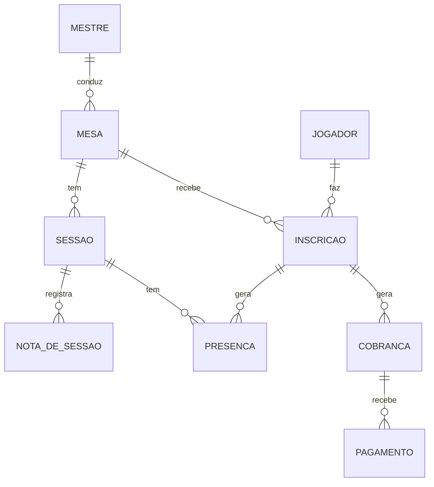
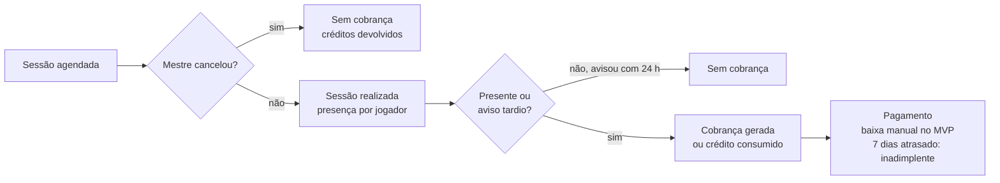

# Gíria Mestre — Planejamento de escopo e regras de negócio

> Versão de 21/10/2026. Documento vivo: a versão editável e comentável está no [Claude Docs](https://claude.ai/artifact/PRT1sMhjivQNb4X9Hr6rmR).

## Premissas e perguntas em aberto

Este plano parte de uma leitura que precisa ser confirmada: **"mesas comissionadas" são mesas de RPG pagas, mestradas sob encomenda**, e a plataforma começa como ferramenta de uso próprio do mestre. Tudo marcado como "padrão sugerido" nas regras de negócio é uma proposta para validar, não uma decisão.

Perguntas que mudam o escopo:

1. As mesas são online, presenciais ou ambas? Em que ferramenta jogam hoje (Discord, Roll20, Foundry, presencial)?
2. A plataforma é só para o mestre ou a ideia é, no futuro, atender outros mestres (produto SaaS)?
3. Como a cobrança é feita hoje: por sessão, pacote de sessões, mensalidade por jogador ou valor fechado pela mesa inteira?
4. Quem paga: cada jogador individualmente ou um contratante que encomenda a mesa para o grupo?
5. Como o pagamento é recebido hoje (Pix, link de pagamento, transferência)? A baixa automática de pagamento precisa estar no MVP?
6. Qual é a política atual de falta, cancelamento e remarcação?
7. Quantas mesas ativas e quantos jogadores existem hoje, e quantos são esperados em 12 meses?
8. Os jogadores vão acessar a plataforma ou, no início, só o mestre usa?
9. Quem vai desenvolver e existe prazo ou orçamento?

## Visão do produto

**Gíria Mestre é a central onde o mestre gerencia cada mesa comissionada, do pedido ao pagamento:** quem joga, quando joga, quanto deve e o que aconteceu na última sessão.

**Problema.** Hoje essa informação costuma ficar espalhada entre WhatsApp, Discord, planilhas e memória. O resultado é cobrança esquecida, conflito de horário entre mesas, jogador que some sem pagar e nenhuma visão clara de quanto as mesas rendem por mês.

**Proposta de valor.**

- Uma agenda única com todas as sessões de todas as mesas.
- Cobranças geradas a partir das sessões realizadas, com o que está pago, pendente e atrasado.
- Histórico de cada mesa: jogadores, presenças e notas de sessão.

**Objetivo do MVP.** Substituir a planilha e o controle manual do mestre: toda sessão agendada, toda presença registrada e toda cobrança rastreada dentro da plataforma.

## Público-alvo e personas

O usuário principal do MVP é o mestre; jogadores e contratantes entram como cadastros e, numa segunda fase, ganham acesso próprio.

| Persona | Quem é | O que precisa | Acesso no MVP |
| --- | --- | --- | --- |
| Mestre | Quem conduz e vende as mesas | Agenda, controle financeiro, histórico das mesas | Total |
| Jogador | Quem participa de uma ou mais mesas | Saber a próxima sessão, confirmar presença, ver o que deve | Apenas cadastro (portal na Fase 2) |
| Contratante | Quem encomenda uma mesa para um grupo, evento ou empresa | Pedir orçamento, aprovar, pagar | Apenas cadastro (pedidos na Fase 2) |
| Outro mestre | Mestre que usaria a plataforma para as próprias mesas | Tudo o que o mestre tem, isolado por conta | Fora do MVP |

## Escopo: MVP, Fase 2 e futuro

O MVP resolve o dia a dia do mestre sozinho; tudo que depende de outra pessoa acessar o sistema ou de integrações externas fica para depois.

**MVP (uso do mestre)**

- Cadastro de mesas: sistema, cenário, formato (online/presencial), vagas, modelo de cobrança, preço e status.
- Cadastro de jogadores e contratantes, com contato e histórico.
- Inscrição de jogadores em mesas.
- Agenda de sessões em calendário, com aviso de conflito de horário.
- Registro de presença por sessão.
- Cobranças geradas a partir das sessões ou pacotes, com baixa manual de pagamento.
- Notas de sessão: resumo, ganchos e pendências para a próxima.
- Painel inicial: próximas sessões, valores a receber, recebido no mês e jogadores em atraso.

**Fase 2 (outras pessoas entram)**

- Portal do jogador: ver agenda, confirmar presença, ver cobranças.
- Formulário público de pedido de mesa, com orçamento e aprovação.
- Lembretes automáticos de sessão e de cobrança (e-mail, WhatsApp ou Discord).
- Pagamento por Pix ou gateway com baixa automática.
- Sincronização com Google Calendar.

**Futuro**

- Multi-mestre (SaaS) com contas isoladas e assinatura.
- Vitrine pública de mesas abertas e avaliações.
- Contratos e termos aceitos digitalmente.
- Relatórios financeiros e fiscais.
- Integração com Discord e Foundry; app mobile.

**Fora de escopo**

- Mesa virtual (VTT), rolagem de dados e mapas: continuam no Roll20, Foundry ou Discord.
- Ficha de personagem completa e chat entre jogadores.

## Requisitos funcionais

São 16 requisitos: 12 entram no MVP e 4 ficam para a Fase 2.

| ID | Requisito | Fase |
| --- | --- | --- |
| RF01 | O mestre faz login com e-mail e senha (ou Google). | MVP |
| RF02 | O mestre cria, edita, pausa, encerra e cancela mesas. | MVP |
| RF03 | Cada mesa define vagas mínimas e máximas, modelo de cobrança e preço. | MVP |
| RF04 | O mestre cadastra jogadores e contratantes com nome, contato e observações. | MVP |
| RF05 | O mestre inscreve e remove jogadores de uma mesa, respeitando o limite de vagas. | MVP |
| RF06 | O mestre agenda sessões avulsas ou recorrentes (ex.: toda quinta às 20h). | MVP |
| RF07 | O sistema avisa quando uma nova sessão conflita com outra já agendada. | MVP |
| RF08 | O mestre marca a sessão como realizada, cancelada ou remarcada e registra a presença de cada jogador. | MVP |
| RF09 | O sistema gera cobranças conforme o modelo da mesa e a presença registrada. | MVP |
| RF10 | O mestre registra pagamentos (total ou parcial), estornos e ajustes. | MVP |
| RF11 | O mestre escreve notas por sessão e consulta o histórico da mesa. | MVP |
| RF12 | O painel mostra próximas sessões, a receber, recebido no mês e inadimplentes. | MVP |
| RF13 | O jogador acessa um portal para ver agenda, confirmar presença e ver cobranças. | Fase 2 |
| RF14 | Um contratante envia pedido de mesa por formulário público e recebe orçamento. | Fase 2 |
| RF15 | O sistema envia lembretes de sessão e de cobrança. | Fase 2 |
| RF16 | O jogador paga por Pix ou link e a cobrança é baixada automaticamente. | Fase 2 |

## Requisitos não funcionais

O sistema precisa ser simples de usar no celular, barato de manter e confiável com dinheiro e dados pessoais.

| ID | Categoria | Requisito |
| --- | --- | --- |
| RNF01 | Usabilidade | Interface responsiva, usada principalmente no celular; registrar presença ou pagamento em até 3 toques. |
| RNF02 | Idioma e formato | Português do Brasil, moeda em BRL, datas no formato dd/mm/aaaa. |
| RNF03 | Fuso horário | Horários guardados em UTC e exibidos no fuso de quem vê (importante para mesas online com jogadores em outros fusos). |
| RNF04 | Segurança | Senhas com hash, HTTPS, sessão com expiração; cada mestre só vê os próprios dados. |
| RNF05 | Privacidade (LGPD) | Coletar só o necessário, registrar consentimento, permitir exportar e excluir dados de um jogador. |
| RNF06 | Integridade financeira | Lançamentos financeiros nunca são apagados; correções viram estorno ou ajuste, com data e autor. |
| RNF07 | Disponibilidade e backup | Backup diário automático do banco; restauração testada antes do lançamento. |
| RNF08 | Desempenho | Telas principais carregam em menos de 2 segundos numa conexão 4G. |
| RNF09 | Custo | Hospedagem no plano gratuito ou de baixo custo enquanto houver um único mestre. |
| RNF10 | Manutenibilidade | Código versionado no GitHub, com testes nas regras de cobrança e cancelamento. |

## Regras de negócio

As regras de cobrança e cancelamento são o coração do sistema; os valores da coluna "Padrão sugerido" ficam configuráveis por mesa e precisam de confirmação.

| ID | Área | Regra | Padrão sugerido |
| --- | --- | --- | --- |
| RN01 | Mesa | Toda mesa tem um mestre responsável e um modelo de cobrança: por sessão, pacote, mensalidade ou valor fechado. | Por sessão |
| RN02 | Mesa | O preço pode ser fixo por jogador ou um valor da mesa dividido entre os jogadores inscritos. | Fixo por jogador |
| RN03 | Mesa | Status possíveis: Rascunho, Inscrições abertas, Em andamento, Pausada, Encerrada, Cancelada. Só mesas Em andamento recebem sessões. | — |
| RN04 | Inscrição | A inscrição não pode passar do número máximo de vagas; excedentes vão para lista de espera. | Lista de espera ativa |
| RN05 | Inscrição | A vaga só é garantida após confirmação e, se a mesa exigir, pagamento de sinal. | Sem sinal |
| RN06 | Inscrição | Jogador inadimplente não pode se inscrever em mesa nova até quitar. | Ativa |
| RN07 | Sessão | Status possíveis: Agendada, Realizada, Cancelada, Remarcada. Remarcar cria uma nova sessão ligada à original. | — |
| RN08 | Sessão | A sessão pode acontecer abaixo do mínimo de jogadores, mas o sistema alerta o mestre. | Alerta, sem bloqueio |
| RN09 | Sessão | Duas sessões do mesmo mestre não podem se sobrepor sem confirmação explícita. | Alerta com confirmação |
| RN10 | Cobrança | No modelo por sessão, cada sessão realizada gera uma cobrança por jogador presente. | Vencimento em 3 dias |
| RN11 | Cobrança | No modelo de pacote, o jogador compra N sessões adiantadas e cada presença consome um crédito. | Pacote de 4, validade de 60 dias |
| RN12 | Cobrança | Na mensalidade, a cobrança é gerada no início do mês, independentemente do número de sessões. | Dia 5 |
| RN13 | Cobrança | Cobrança vencida e não paga após o prazo de tolerância marca o jogador como inadimplente. | 7 dias |
| RN14 | Cancelamento | Jogador que avisa a ausência com antecedência não é cobrado (ou não perde crédito). | 24 horas |
| RN15 | Cancelamento | Aviso fora do prazo ou falta sem aviso é cobrado como presença. | Cobrança integral |
| RN16 | Cancelamento | Sessão cancelada pelo mestre não gera cobrança e devolve créditos de pacote. | — |
| RN17 | Financeiro | Pagamento pode ser parcial; a cobrança só fica Paga quando o total é quitado. | — |
| RN18 | Financeiro | Nenhum lançamento financeiro é excluído; correções são feitas por estorno ou ajuste com motivo. | — |
| RN19 | Dados | Excluir um jogador anonimiza os dados pessoais, mas mantém o histórico financeiro. | — |

## Entidades e modelo de dados

O MVP precisa de 9 entidades; a Inscrição é a peça central, porque é ela que diz quem joga em qual mesa e quem deve o quê.

A cobrança nasce da presença registrada (por sessão), do pacote comprado ou do mês (mensalidade), sempre ligada a uma inscrição.

| Entidade | Atributos principais |
| --- | --- |
| Mestre | nome, e-mail, fuso horário |
| Mesa | nome, sistema, cenário, formato, vagas mínimas e máximas, modelo de cobrança, preço, status |
| Sessão | mesa, data e hora (UTC), duração, status, sessão de origem quando remarcada |
| Nota de sessão | sessão, resumo, ganchos, pendências |
| Jogador / contratante | nome, contatos (WhatsApp, Discord, e-mail), tipo, observações, inadimplente |
| Inscrição | mesa, jogador, status (ativa, lista de espera, saiu), data de entrada, créditos de pacote |
| Presença | sessão, inscrição, status (presente, ausente com aviso, falta) |
| Cobrança | inscrição, origem (sessão, pacote ou mês), valor, vencimento, status (pendente, paga, atrasada, cancelada) |
| Pagamento | cobrança, valor, data, forma, tipo (pagamento, estorno, ajuste) |
| Pedido de mesa (Fase 2) | contratante, descrição, número de jogadores, datas desejadas, orçamento, status |

## Fluxos principais

O fluxo mais importante é o que vai da sessão agendada até o pagamento, porque concentra as regras de cancelamento e cobrança.

Aviso tardio = ausência avisada com menos de 24 h ou falta sem aviso (RN14, RN15). A decisão de cobrar é tomada jogador por jogador, a partir da presença registrada pelo mestre.

**Criar e conduzir uma mesa**

1. O mestre cria a mesa como Rascunho e define sistema, vagas, modelo de cobrança e preço.
2. Abre as inscrições e inscreve os jogadores; quem passa do limite vai para a lista de espera.
3. Com o mínimo de jogadores, a mesa passa para Em andamento.
4. O mestre agenda as sessões (avulsas ou recorrentes) e segue o fluxo acima a cada sessão.
5. Ao fim da campanha, a mesa é Encerrada; o histórico e o financeiro continuam consultáveis.

**Fechar o mês**

1. O mestre abre o painel e vê o total recebido, a receber e em atraso.
2. Filtra as cobranças pendentes e cobra os jogadores pelo canal de costume.
3. Registra os pagamentos recebidos; o sistema marca inadimplentes automaticamente.

**Pedido de mesa (Fase 2)**

1. O contratante preenche o formulário público: sistema desejado, número de jogadores e datas.
2. O mestre analisa e envia um orçamento.
3. Aprovado o orçamento (e pago o sinal, se houver), o pedido vira uma mesa em Rascunho.

## Métricas de sucesso

O MVP dá certo se, depois de um mês de uso, o mestre não precisar mais da planilha.

- 100% das sessões do mês registradas na plataforma.
- Nenhuma cobrança esquecida: toda sessão realizada tem cobrança gerada.
- Queda do valor em atraso em relação ao mês anterior ao uso.
- Tempo para fechar o financeiro do mês abaixo de 10 minutos.
- Fase 2: pelo menos metade dos jogadores confirmando presença pelo portal.

## Riscos e mitigação

O maior risco é construir demais antes de validar: o MVP deve ir para uso real o quanto antes.

| Risco | Impacto | Mitigação |
| --- | --- | --- |
| Escopo crescer (VTT, fichas, chat) antes do básico funcionar | Alto | Manter a lista "Fora de escopo" e só abrir a Fase 2 depois de um mês de uso do MVP |
| Regras de cobrança mal definidas geram valores errados | Alto | Fechar as regras deste documento antes de codar e cobri-las com testes automatizados |
| Registrar no sistema dá mais trabalho que a planilha | Alto | Fluxos de 3 toques no celular; sessões recorrentes e cobranças geradas automaticamente |
| Jogadores não aderirem ao portal (Fase 2) | Médio | Lembretes e links diretos pelo canal que já usam (WhatsApp ou Discord) |
| Vazamento de dados pessoais | Médio | Coletar o mínimo, autenticação segura, isolamento de dados por mestre, LGPD desde o início |
| Fuso horário errado em mesas online | Médio | Guardar tudo em UTC e testar com jogadores em fusos diferentes |
| Dependência de gateway de pagamento (taxas, mudanças de API) | Baixo | Baixa manual no MVP; integração isolada em um módulo na Fase 2 |

## Checklist pré-desenvolvimento e próximos passos

O próximo passo é responder as perguntas do início; com elas fechamos as regras e partimos para protótipo e arquitetura.

**Produto**

- [x] Rascunho de visão, escopo, requisitos e regras (este documento)
- [ ] Responder as perguntas em aberto e confirmar os padrões sugeridos
- [ ] Escrever as histórias de usuário do MVP com critérios de aceite
- [ ] Priorizar o backlog do MVP (o que entra na primeira versão utilizável)

**Design**

- [ ] Wireframes das telas principais: painel, mesa, agenda, sessão, financeiro
- [ ] Protótipo clicável e teste rápido com uso real
- [ ] Identidade visual básica (nome, cores, tipografia)

**Técnico**

- [ ] Escolher a stack (sugestão: Next.js + Supabase com Postgres e autenticação + hospedagem na Vercel, todos com plano gratuito)
- [ ] Modelar o banco a partir das entidades deste documento
- [x] Criar o repositório
- [ ] Ambiente de desenvolvimento e deploy automático
- [ ] Definir estratégia de testes (unitários nas regras de cobrança e cancelamento)

**Legal e operação**

- [ ] Termos de uso e política de privacidade (LGPD)
- [ ] Política de cancelamento escrita para os jogadores
- [ ] Plano de migração dos dados da planilha atual

**Roadmap sugerido:** 1) fechar regras e wireframes; 2) construir o MVP; 3) usar com as mesas reais por um mês e ajustar; 4) iniciar a Fase 2.
